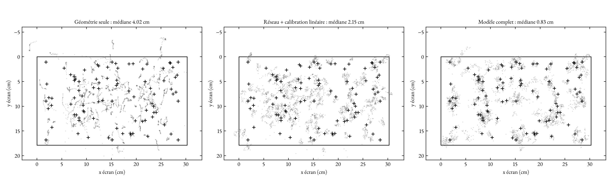
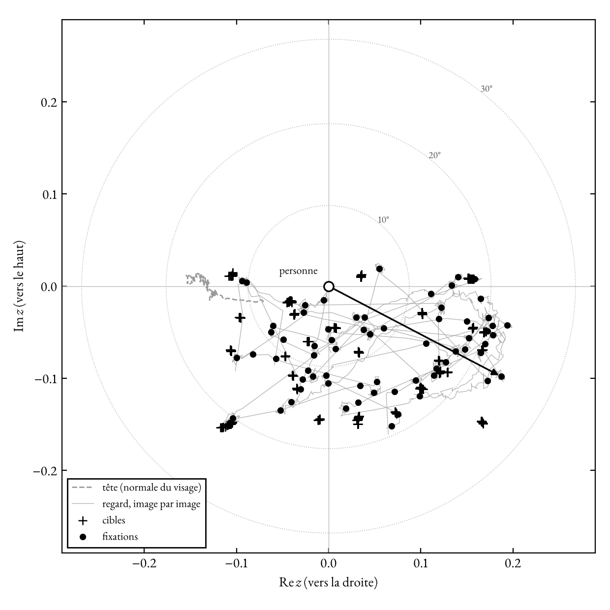

# Webcam eye tracker

An eye tracker that needs nothing but the built-in webcam of a laptop. After a five-minute calibration, it tells you where on the screen a person is looking, frame by frame, with a median error of 0.83 cm (0.88°) on targets it has never seen. It comes with everything needed to use it in practice: a recorder you drop into any web page, a test page for images, areas of interest, heatmaps, and plain CSV/JSON outputs in screen pixels.

Typical uses:

- usability testing of a website: which buttons are seen, how fast, how often people come back to them, what they look at before clicking;
- studying how people look at an image, a poster or a product photo;
- research on gaze itself (fixations, saccades, head–eye coordination), with the raw angles and the full geometry exposed.



## How it works

The difficulty of webcam eye tracking is that the eye is tiny in the picture (an iris is about 20 pixels wide at 50 cm) and that the head moves. The tracker combines three sources of information, each covering the weaknesses of the others.

1. 3D geometry. MediaPipe places 478 points on the face, 16 of them around each eye, and gives the head pose. The focal length of the webcam is estimated from the size of the iris (the human iris is 11.8 mm wide with very little variation between people), which gives the 3D position of both eyes. A physical model of the eyeball (two spheres, the eyeball and the cornea) turns the position of the iris centre into a gaze direction.
2. Appearance. Two neural networks pre-trained on public datasets (MPIIFaceGaze and ETH-XGaze) read a normalised picture of the face, which makes them robust to lighting and head rotation.
3. Calibration, in two stages. A linear layer maps the networks' output onto the screen; it extrapolates safely outside the calibrated area. A kernel ridge regression then corrects the remaining error inside the calibrated area, reading the eye-contour landmarks, the eye pixels themselves and the networks' internal features.

The gaze direction is then intersected with the screen plane, smoothed (One Euro filter, blink removal) and segmented into fixations and saccades by an optimal partition of the time series (dynamic programming).

The project also describes gaze in the complex plane: the direction is mapped to z = (u + iv)/(1 + w) by stereographic projection, so that the person sits at 0, |z| = tan(ε/2) gives the eccentricity and arg z the direction. Head rotations then act on z as Möbius transformations, the point on the screen is 2Dz/(1 − |z|²), and over time a fixation is a segment parallel to the time axis, a saccade a jump and a smooth pursuit an arc.



The full write-up, with every derivation, is in [article/eye_tracker.pdf](article/eye_tracker.pdf) (in French, 18 pages). It compiles with `latexmk -lualatex eye_tracker.tex` in `article/` and needs the EB Garamond and Garamond-Math fonts, both in TeX Live.

## Accuracy

On-screen error, median per frame, over 3,974 fixation frames of a 5-minute calibration session (5 rounds, one head posture per round). No test frame was used for fitting.

| | Geometry only | Networks + linear calibration | Full model |
|---|---|---|---|
| Targets never seen | 4.02 cm (p90 7.45) | 2.15 cm (p90 5.11) | 0.83 cm (p90 2.08) |
| Head posture never seen | 5.52 cm | 2.65 cm | 2.68 cm |
| Posture never seen + 5-point recalibration | 3.04 cm | 2.05 cm | 2.18 cm |

- Targets never seen: 5-fold cross-validation grouped by target, so the model never saw any frame of a test target.
- Head posture never seen: each round is left out in turn; the table gives the mean of the 5 medians.
- + 5 points: the first 5 grid points of the left-out round are used for an affine recalibration.

For comparison, the public networks without calibration reach 4.81 cm (MPIIFaceGaze) and 4.64 cm (ETH-XGaze). Per fixation (median of the predictions over a fixation), the full model reaches 0.66 cm (p90 1.70); frame-to-frame noise during a fixation is 0.39 cm.

A rule of thumb for study design: at 50 cm, 0.9° is about 0.8 cm, i.e. about 40 CSS pixels on a 14-inch MacBook Pro. Areas of interest should be at least 2 to 3 cm wide.

## Installation

```bash
python3 -m venv .venv
.venv/bin/pip install -r requirements.txt
```

Python 3.11 or later. Everything runs on the CPU; Chrome is used for the calibration and recording pages.

## Step 1: calibrate (once per person and per setup)

```bash
.venv/bin/python code/start_calibration.py
.venv/bin/python code/calibrate.py data/calibration/calib_XXX.mp4 --log data/calibration/calib_XXX.json
```

`start_calibration.py` opens the calibration page in full screen. You choose your screen (MacBook Pro and Air models and common external monitors are recognised from the resolution; any other screen is described by its diagonal and the position of the webcam), then follow a yellow dot with your eyes for 5 rounds of about one minute, changing your head posture slightly between rounds as the page tells you. The video and its log are saved in `data/calibration/`.

`calibrate.py` extracts the face landmarks and the network outputs, runs the cross-validation, and writes the model to `models/calib_XXX.pkl`, the screen description to `models/calib_XXX_screen.json` and the validation report to `results/data/report.json`. It takes about ten minutes on 4 cores, and resumes from its checkpoints if interrupted.

## Step 2: record a session

On a website. Start the local server, then add one line to the page you want to test and mark the elements you care about:

```bash
.venv/bin/python code/start_session.py
```

```html
<script src="http://localhost:8766/gaze-recorder.js" data-upload="http://localhost:8766/upload"></script>

<button data-gaze-aoi="buy button">Buy now</button>
<nav data-gaze-aoi="menu">...</nav>
```

A small "Record gaze" button appears in the bottom-right corner. When recording starts, the page goes full screen, flashes white once (to synchronise the video with the page clock) and shows 9 dots to look at. Those check points are used to recalibrate for the current posture and to measure the error of the session. While the person browses, the recorder logs the scroll position, the position and size of every marked element, clicks and page changes. It never records keystrokes or form content. With `data-auto="on"`, links, buttons, images, headings and forms are tracked automatically without marking anything. The recording can also be driven from the page's own code with `GazeRecorder.start()`, `GazeRecorder.mark("step 2")` and `GazeRecorder.stop()`. Files go to `data/sessions/`, or are downloaded if the server cannot be reached. Browsers only allow the camera on `https` pages or on `localhost`. [web/demo_site.html](web/demo_site.html) is a complete example.

On images:

```bash
.venv/bin/python code/start_session.py --image poster.jpg --image photo.jpg --seconds 10
```

shows the images one after the other in full screen and records the session.

Any other video of the face, filmed by the calibrated webcam, can be analysed directly in step 3 without a session log.

## Step 3: analyse

```bash
.venv/bin/python code/track.py data/sessions/session_X.mp4 --model models/calib_XXX.pkl --session data/sessions/session_X.json
```

Useful options:

- `--aoi areas.json`: statistics for your own areas of interest (rectangles, circles or polygons, in screen, page or image pixels). They can also be applied afterwards with `python code/aoi.py results/tracking/session_X areas.json`.
- `--heatmap-space page --background full_page_screenshot.png`: draws the heatmap on a full-page screenshot rather than on a blank screen. `--heatmap-space image` draws it on the tested image.
- `--screen-model my_screen.json`: uses another screen description (same webcam, different screen or resolution; see `code/screen.py`).
- `--plots` adds time-series and complex-plane plots, `--video` an annotated video.

Everything is written to `results/tracking/session_X/`:

| File | Content |
|---|---|
| `gaze.csv` | one row per webcam frame: time, gaze point in screen pixels and mm, in browser-window and page coordinates (scrolling included), element under the gaze and position inside it, blink or missing face, fixation id |
| `fixations.csv` | one row per fixation or smooth pursuit: start, end, duration, position, saccade amplitude, element |
| `aoi_elements.csv` | one row per marked element: number of fixations, dwell time and share, time to first fixation, first and mean fixation duration, visits and revisits, clicks and time to first click |
| `aoi_<name>.csv` | the same statistics for each `--aoi` file |
| `heatmap_<space>.png` | heatmap of fixations weighted by duration, with the numbered scanpath |
| `gaze.json` | all of the above, plus the session metadata, the measured error of the check points, and per frame the head–eye decomposition and the complex-plane coordinates |

Every format, coordinate system and column is documented in [docs/formats.md](docs/formats.md), including the derivation of the gaze-to-pixel formula.

## Step 4: look at the results

[web/viewer.html](web/viewer.html) opens directly in a browser. Drop a `fixations.csv` and a screenshot, then choose the coordinate system, the blur and the time window.

The CSV files load as they are in any tool. For example, the time spent on each element, in seconds:

```python
import pandas as pd
g = pd.read_csv("results/tracking/session_X/gaze.csv")
ok = g[(g.phase == "session") & (g.status == "ok")]
print(ok.groupby("element").t_ms.count() / 30)
```

## How reliable is a session?

The 9 check points at the start of each session answer that question for every recording: `track.py` fits the recalibration on 5 of them, measures the error on the other 4, writes that number to `gaze.json`, applies the recalibration only if it helps, and prints a warning above 3 cm. On the provided data, with a model that had never seen the fourth round, the recalibration brought the error on the held-out points from 5.2 to 1.8 cm, and the median error on the remaining 19 targets of that round from 3.5 to 1.2 cm.

## Repository layout

```
article/            LaTeX write-up and PDF (French)
calibration/        calibration page and screen presets (screens.json)
code/               Python source, MediaPipe model and network weights
data/calibration/   calibration log (the video itself is not versioned)
data/sessions/      recorded sessions (not versioned)
docs/formats.md     formats guide: screen, sessions, CSV/JSON outputs, areas of interest
models/             calibrated model and its screen description
results/figures/    all figures of the write-up
results/data/       all tables (CSV) and the validation report (JSON)
web/                recorder for web pages, image test page, demo site, viewer
```

| File | Role | Time complexity |
|---|---|---|
| `code/extract.py` | MediaPipe landmarks, head pose, blendshapes, brightness | O(N) |
| `code/appearance.py` | face normalisation and pre-trained networks | O(N) |
| `code/eye_patches.py` | 64×32 crops of both eyes, aligned on their corners | O(N) |
| `code/dataset.py` | focal length, flash synchronisation, labels, screen geometry | O(N F) for F tested offsets |
| `code/gaze_model.py` | physical model, linear calibration, kernel residual, recalibration | O(Nc³) to fit, O(N Nc) to predict |
| `code/fixations.py` | blinks, One Euro filter, optimal segmentation into fixations | O(N²) per continuous block |
| `code/complex_gaze.py` | stereographic projection, head–eye Möbius maps, complex-plane plots | O(N) |
| `code/calibrate.py` | cross-validation (10 folds), final model, report | O(P Nc³), P = 10 |
| `code/make_results.py` | figures and tables of the write-up | O(N + Nc³) |
| `code/track.py` | gaze in screen, window, page and element pixels, fixations, areas of interest, quick recalibration | O(N Nc + N² + N A) |
| `code/screen.py` | screen model (size, resolution, webcam) and mm-to-pixel conversion | O(N) |
| `code/session.py` | web session log: scrolling, window, elements under the gaze, check points | O(N E) |
| `code/aoi.py` | areas of interest and their statistics | O(N A + Fx A) |
| `code/heatmap.py` | heatmap and scanpath | O(W H / c² + Fx) |
| `code/start_calibration.py` | serves the calibration page and receives the recording | O(video size) |
| `code/start_session.py` | serves the recorder and the image page, receives sessions | O(video size) |
| `web/gaze-recorder.js` | gaze recorder to include in a web page | O(E) per page state |

N: frames; Nc ≈ 4,000: calibration frames; Fx: fixations; A: areas of interest; E: recorded elements per page state; W × H: heatmap size, c = 4 px per cell. Long steps save their progress (every 500 frames, then after every validation fold) and resume where they stopped.

To rebuild every figure and table of the write-up: `.venv/bin/python code/make_results.py --video data/calibration/calib_20261025_102754.mp4`.

## Data

- `results/data/frames.csv`: one row per frame (9,283) with the target, the head posture and the cross-validated predictions of the three models.
- `results/data/summary.csv`, `rounds.csv`, `targets.csv`: errors per protocol, per round and per target.
- `results/data/physical_parameters.csv`: fitted parameters of the eyeball model.
- `results/data/timeline_round2.csv`, `events_round2.csv`: time series and fixations of round 2, predicted without having seen it.
- `results/data/complex_round2.csv`: round 2 in the complex plane.
- `data/calibration/calib_20261025_102754.json`: raw calibration log. The video (296 MB) is not versioned.

## Limitations

- One person and one session. Another person needs their own calibration.
- The hyperparameters (16 and 24 PCA components, regularisation 0.1) were chosen on these same folds: expect 0.1 to 0.2 cm more on a new session.
- A head posture absent from the calibration costs about 2.7 cm without recalibration, hence the check points at the start of each session.
- The webcam is assumed to lie in the plane of the screen; its position is set in `screen.json` (centre of the notch, 3.4 mm below the top edge of the picture, for the provided session). Changing screen or resolution does not require a new calibration; changing webcam does.
- Processing is offline, about 7 frames per second per CPU core for the networks.

## Privacy

The face video never leaves the machine: the recorder sends it only to the local server, and all processing is local. Recording someone else requires their informed consent.

## License and credits

The code is released under the MIT License (see [LICENSE](LICENSE)).

- MediaPipe Face Landmarker (Google, Apache 2.0).
- Network weights from [hysts/pytorch_mpiigaze_demo](https://github.com/hysts/pytorch_mpiigaze_demo) (MIT code), trained on MPIIFaceGaze and ETH-XGaze, whose data are under non-commercial licenses (CC BY-NC-SA). The weights therefore inherit those terms: this project is a research demonstrator, not a commercial product.
